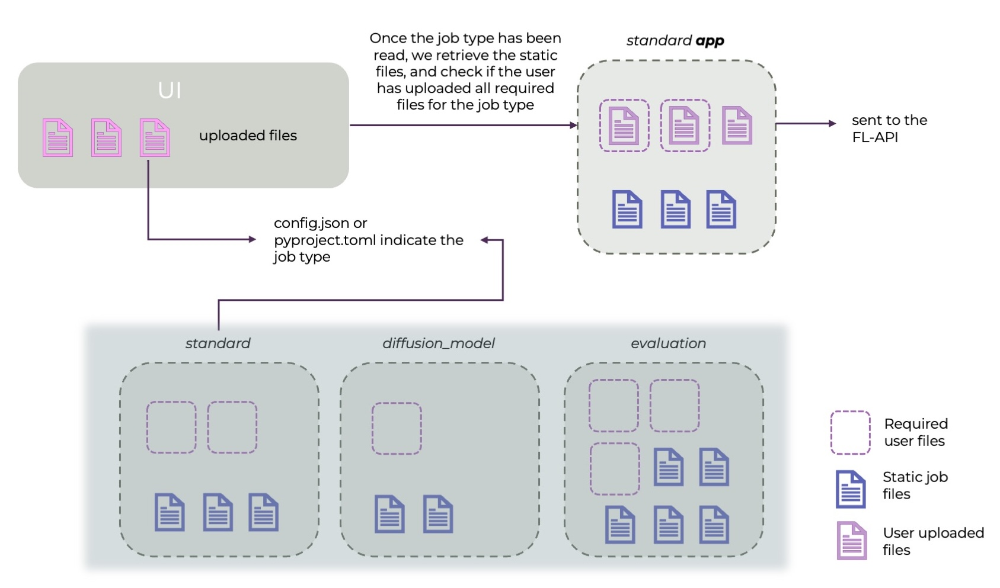

.. _flip-fl-nets:
.. _flip-fl-nodes:

#######
FL nets
#######

FLIP supports two federated learning frameworks, :term:`NVIDIA FLARE` and the :term:`Flower Framework`. On both,
the FL services are deployed as a set of **nets**. A net is one FL API and one FL server on the Central Hub, plus
one FL client at every participating Trust. The hub's scheduler hands each queued training job to a free net.

.. contents:: On this page
   :local:
   :depth: 2

**********************
Nets and the scheduler
**********************

.. figure:: ../assets/support/flip_components_nets_and_scheduler.png
   :align: center
   :alt: The FLIP scheduler on the cloud-hosted hub connected to two nets. Each net has an FL API and an FL
         server on the hub and an FL client with a GPU at Trust A and at Trust B, on either backend.

   The FLIP scheduler assigns queued jobs to a free net. Each net is one FL API and FL server on the hub and
   one FL client per participating Trust, running either backend.

What a net is made of
=====================

.. list-table::
   :header-rows: 1
   :widths: 16 44 20 20

   * - Component
     - What it does
     - NVFLARE
     - Flower
   * - **FL server**
     - Orchestrates training across sites, aggregates the weights and uploads the results at the end.
     - FLARE server
     - SuperLink
   * - **FL client**
     - Trains locally on its site's data and sends weight updates to the server. One per Trust per net. The
       only component that runs deep learning, so the only one that needs a GPU.
     - FLARE client holding the Trust's signed startup kit
     - SuperNode
   * - **FL API**
     - A small FastAPI service in front of the server that launches jobs and reports their status. The only FL
       component the Central Hub API talks to.
     - Wraps the FLARE admin session
     - Wraps ``flwr``; also registers the SuperNodes' authentication keys with the SuperLink at start-up

The FL API and server run on the Central Hub (in the cloud). Clients run at the Trusts taking part in a project
(cloud or on-premise). Service names follow the net:

- ``fl-api-net-N`` and ``fl-server-net-N`` on the hub;
- ``fl-client-net-N`` at each Trust.

Each net has its own FL network (``fl-net-N``) whose only members are that net's server and clients. The Central
Hub API and the FL API are not on it, and an FL client has no hub URL or hub credential. Trusts connect
**outbound** to the server, with mutual TLS using the per-participant certificates in the provisioned kits.

.. warning::

   **FL apps must work offline.** Neither the FL server nor a Trust's training host can be assumed to reach the
   public internet: on a platform-managed estate the server's egress passes a firewall that allows only the
   platform's own endpoints, and Trust hosts sit behind the Trust's firewall. Everything an app needs (weights,
   checkpoints, auxiliary networks) must arrive as uploaded model files, never as a run-time download (see
   *Model files* in the :ref:`user guide <model-files>`).

   A ``pretrained=True`` or ``torch.hub`` call hangs the job on the server. On NVFLARE the Trust then reports
   ``cannot sync with server Runner``; on Flower the run never starts a round. Either way the model stays
   ``INITIATED`` and the net ``BUSY``.

Kit slots and client names
==========================

The FL server knows a client by the name in its certificate, not by the Trust's hub-side name. These names are
the **FL kit slots** (``Trust_1``, ``Trust_2``, …): a fixed pool provisioned once per net, from which each Trust
claims one when it registers with the hub. The slot name is what appears in FL logs, and what an app's
``AGGREGATION_WEIGHTS`` keys must use (see :ref:`fl-training-configuration`).

How a job reaches a net
=======================

Starting training on a model creates a **job** in the hub's queue. On each scheduler tick the Central Hub API:

#. frees any net whose job has finished or been deleted;
#. stops here if **deployment mode** is on (see below);
#. locks one ``AVAILABLE`` net and marks it ``BUSY``;
#. takes the oldest ``QUEUED`` job and marks it ``IN_PROGRESS``, retiring any job whose Trusts are no longer
   approved for the model; if the queue is empty, it releases the net again;
#. bundles the app (the researcher's uploaded files plus the platform's template for the job type, see
   :ref:`fl-required-files`), uploads it to that net's FL API and submits it.

Each net trains one job at a time. The queue is first-come, first-served, and the UI shows a waiting model's
queue position. Each net's backend (NVFLARE or Flower) is recorded on the hub when the nets are seeded, and
decides which template is bundled: **the deployment chooses the backend, not the model**.

A job's server-side process reports the model's final status to the hub itself. If that process dies first (out
of memory, killed, or lost in a server restart), the hub's **job watchdog** catches it. It compares each running
job with its net's job list; a job the FL server has ended or no longer has, while the model is still running,
is set to ``ERROR`` after several checks in a row. The model's log records what the FL server reported, and the
net moves on to the next queued job. A job still being prepared after a timeout is treated the same way.

An FL API the hub cannot reach fails nothing: the net shows as offline on the Connection Status page instead.

The hub settings that control this (all in minutes, except the strike count):

.. list-table::
   :header-rows: 1
   :widths: 40 45 15

   * - Setting
     - What it controls
     - Default
   * - ``SCHEDULER_RUN_JOBS_RATE``
     - How often the scheduler runs the steps above.
     - 1
   * - ``SCHEDULER_FL_JOB_WATCHDOG_RATE``
     - How often the watchdog checks running jobs.
     - 1
   * - ``FL_JOB_WATCHDOG_STRIKES``
     - Consecutive failed checks before a job is set to ``ERROR``.
     - 3
   * - ``FL_JOB_PREPARE_TIMEOUT_MINUTES``
     - How long a job may stay in preparation after pickup.
     - 30

GPU requirements and NVFLARE's scheduler
========================================

On NVFLARE, a job states how many GPUs it needs at each Trust (``num_of_gpus`` in its ``meta.json``
``resource_spec``; see :ref:`fl-nvflare-meta-json`). The value is the job's own declaration, a per-run
override, or the hub default ``JOB_RESOURCE_SPEC_NUM_GPUS``. Each Trust's FL client
states what it has, from ``NUM_AVAILABLE_GPUS`` in its kit.

Before starting a job, the FL server asks every Trust whether it can provide its share. **FLIP never lowers the
request to fit a Trust**, because that would quietly train a GPU job on a CPU.

If a Trust cannot provide the GPUs, NVFLARE holds the job and retries with a growing delay (10 s, doubling up to
10 minutes). After 10 tries (about 40 minutes) it gives up and marks the job ``FINISHED:CAN_NOT_SCHEDULE``. Each
refusal appears in the model's activity feed, against the Trust that could not provide the resources:

- while NVFLARE keeps trying: *Waiting for resources · this trust cannot provide 1 GPU · try 2 of 10*;
- on the last try: *Training could not start · … · NVFLARE gave up after 10 tries*. The model then turns
  ``ERROR`` and the net is freed. This final update is retried for about a minute until the hub accepts it; if
  the hub is unreachable for longer, the job watchdog fails the model once NVFLARE lists the job as failed.

.. important::

   Some jobs stall **before** NVFLARE asks the Trusts for resources, and then the hub hears nothing: the model
   stays ``INITIATED`` and the net ``BUSY`` until someone clicks **Abort job**. This happens when:

   - the job has no deploy map (NVFLARE refuses it outright);
   - one of its Trusts is not connected (FLIP makes every Trust in a run mandatory);
   - fewer Trusts are connected than the job's ``min_clients``.

   NVFLARE retries the last two as above, but still lists the job as pending, so the job watchdog does not catch
   them either.

**Abort job** also removes a job still waiting in the FL server's queue (NVFLARE marks it ``FINISHED:ABORTED``),
so it cannot start later or report to the model once that model has been queued again.

To run a GPU model, either the Trust adds GPUs or the model goes to Trusts that have them. A CPU-only Trust
(``NUM_AVAILABLE_GPUS=0``) can only take part in jobs that ask for no GPUs.

Deployment mode (quiescing the nets)
====================================

Replacing an FL server kills any training run in flight on its net. Before redeploying, an administrator can
switch the hub into **deployment mode**:

- the scheduler stops picking up queued jobs; they keep their place and resume, oldest first, when the mode is
  switched off;
- running jobs finish and free their nets.

``GET /api/fl/quiesce`` reports the mode and whether any net is still ``BUSY``. When no net is busy, it is safe to
redeploy. The admin workflow is on :doc:`/sys-admin/admin-project-and-user-management`.

*********
Job types
*********

For security, FLIP users cannot control what runs on the FL server. Most of what a researcher adjusts happens on
the client side (data loading, training loop, model architecture); for the server side, FLIP offers a choice of
**job types**. Which ones are available depends on the backend:

.. list-table::
   :header-rows: 1
   :widths: 22 48 15 15

   * - Job type
     - What the server does
     - NVFLARE
     - Flower
   * - ``standard``
     - Federated averaging.
     - Yes
     - Yes
   * - ``evaluation``
     - Evaluates a model at each Trust and collects the metrics.
     - Yes
     - Yes
   * - ``diffusion_model``
     - Two-stage diffusion model training.
     - Yes
     - No
   * - ``fed_opt``
     - Federated optimisation. Same client contract as ``standard``; only the server-side optimiser aggregation
       differs.
     - Yes
     - No

Every NVFLARE job type runs your code through the **NVFLARE Client API**: a plain training or evaluation script
that uses ``nvflare.client``. The manifests under :ref:`fl-required-files` are the authoritative list of job types
for each backend. More job types will be added as the community needs them.

**Evaluation metrics.** On both backends the FL server sends each Trust's returned metrics to the hub, so they
appear on the model page as one point per Trust (at round 0 on NVFLARE, round 1 on Flower). Aggregate metrics
are forwarded with upper-cased names, leaving out undefined values such as NaN.

- **NVFLARE**: evaluation code needs nothing extra, and nested metric keys are joined with ``/``. An evaluator can
  also keep results out of the plots and in the results file only; see the evaluation template's README.
- **Flower**: the client must name itself with ``client_name`` (or ``site``) in its reply config.

How to choose a job type
========================

An app is the set of files (Python, JSON, TOML…) that makes up a federated learning job. Some files are required;
which ones depends on the job type (see :ref:`fl-required-files`).

Set the job type with the ``job_type`` key in the app's ``config.json``, on both NVFLARE and Flower:

- an unrecognised value is rejected at submission;
- a missing key falls back to ``standard``;
- ``config.json`` itself is required for every job type, so an app without it is rejected before bundling.

After you upload files, the UI shows which files the job type requires. The Central Hub API then bundles your
uploaded files together with the job type's static (non-modifiable) template files.

         submitting the job.
   :align: center

   Workflow of how the user uploads files for a specific job type.

The per-job-type templates are under :gh:`fl-apps/ <fl-apps>`.
The NVFLARE tutorials show them in use:

- :gh:`xray_classification <fl-tutorials/nvflare/image_classification/xray_classification>` (job type ``standard``)
- :gh:`3d_spleen_segmentation <fl-tutorials/nvflare/image_segmentation/3d_spleen_segmentation>` (job type ``standard``)
- :gh:`3d_spleen_segmentation_evaluation <fl-tutorials/nvflare/image_evaluation/3d_spleen_segmentation_evaluation>` (job type ``evaluation``)
- :gh:`latent_diffusion_model <fl-tutorials/nvflare/image_synthesis/latent_diffusion_model>` (job type ``diffusion_model``)
- :gh:`ehr_risk_prediction <fl-tutorials/nvflare/tabular_classification/ehr_risk_prediction>` (job type ``standard``)

The three ``standard`` tutorials show one job type running very different apps: each is supervised federated
averaging, but the data, architecture and training configuration differ. The EHR one has no imaging at all. A
job type describes the NVFLARE job FLIP builds around your files, not the data modality; what to fetch is your
script's decision (an imaging app calls ``flip.get_by_accession_number``, the EHR app only
``flip.get_dataframe``).

The tutorials run on the local NVFLARE simulator from the repo root. The imaging ones need a GPU; the EHR one
runs on CPU:

.. code-block:: shell

   make -C fl-tutorials run-tutorial TUTORIAL=xray_classification

.. seealso::

   The :gh:`fl-tutorials/ <fl-tutorials/nvflare>` README.

.. _fl-required-files:

***************************
Required files per job type
***************************

Each job type has its own set of required files. A submission missing any of them is rejected before anything
is sent to a Trust, with a message naming the missing files.

The manifests below are included **directly from the repository**, so this page always matches the platform.
Each key is a job type and its array is the exact set of files that job type requires. The FLIP UI shows the
same list on the model page.

.. literalinclude:: ../../../fl-apps/nvflare/required_files.json
   :language: json
   :caption: ``fl-apps/nvflare/required_files.json`` — required files per NVFLARE job type

.. literalinclude:: ../../../fl-apps/flower/required_files.json
   :language: json
   :caption: ``fl-apps/flower/required_files.json`` — required files per Flower job type

.. note::

   Every job type lists ``config.json``, because its ``job_type`` key selects the job type; an app without it
   could only ever run ``standard``. On NVFLARE it also holds the training configuration described below. On
   Flower it holds nothing else: Flower apps take their run configuration from ``config.toml``.

   You do **not** supply ``pyproject.toml`` for a Flower app. It comes with the platform's template; a
   ``pyproject.toml`` uploaded as a model file does not become the app's project file. Put per-run overrides in
   ``config.toml`` instead (see below).

Other files uploaded with the model are bundled into the app too, which is how apps ship helper modules and
transforms, with two exceptions:

- **A file whose name matches one the template already provides is silently dropped.** The template's copy wins,
  and the only trace is a server-side log line; no error reaches the UI. On Flower this covers ``server_app.py``,
  ``strategy.py``, ``__init__.py`` and ``pyproject.toml`` (the Flower tutorials ship the first three in their app
  directories). On NVFLARE it covers whatever the job type's template contains.
- **A checkpoint declared for server-side use is not sent to the Trusts.** A file named by
  ``SERVER_CHECKPOINT``, or by an evaluation job's ``models`` entries, is staged on the FL server instead of the
  app bundle. This keeps large weights off the client deployment path.

.. _fl-training-configuration:

**********************
Training configuration
**********************

NVFLARE ``config.json``
=======================

For NVFLARE job types, ``config.json`` holds the job type and the training settings the platform recognises.
Every setting has a default, so an app that declares only ``job_type`` is valid.

.. code-block:: json

    {
      "job_type": "standard",
      "GLOBAL_ROUNDS": 5,
      "LOCAL_ROUNDS": 2,
      "IGNORE_RESULT_ERROR": false,
      "AGGREGATOR": "InTimeAccumulateWeightedAggregator",
      "AGGREGATION_WEIGHTS": {
         "Trust_1": 1.0,
         "Trust_2": 0.5
      }
    }

**GLOBAL_ROUNDS**
   Number of global (server-side) rounds: how many times the server distributes the global model, collects
   client updates and aggregates them. Range 1–1000 inclusive.

   *Default = 1*

**LOCAL_ROUNDS**
   Number of local training iterations at each client per global round. Range 1–1000 inclusive.

   *Default = 1*

   .. note::

      An invalid value (not a number, or out of range) is **discarded without an error**, with different effects
      for the two keys:

      - **GLOBAL_ROUNDS** is read by the platform, so an invalid value gives a **one-round run**. If training
        finishes sooner than expected, check this value. With ``BEST_MODEL_METRIC`` set, which needs at least
        two rounds, an invalid value fails the job instead.
      - **LOCAL_ROUNDS** is read by your own trainer, not the platform. The default is filled in only when the
        key is *absent*; a present but invalid value reaches your trainer unchanged. ``"LOCAL_ROUNDS": 5000``
        runs 5000 local iterations, and a non-numeric value fails inside your code.

      Neither key is rewritten in the ``config.json`` deployed with the app, so app code reading
      ``GLOBAL_ROUNDS`` from that file sees what you wrote, not what the server uses.

**IGNORE_RESULT_ERROR**
   Whether training continues when a client returns an error.

   *Default = false*

**AGGREGATOR**
   The NVFLARE aggregation component that combines client updates. Only built-in NVFLARE aggregators are
   supported: ``InTimeAccumulateWeightedAggregator`` or ``AccumulateWeightedAggregator``. Any other value fails
   validation and training does not start.

   *Default =* ``InTimeAccumulateWeightedAggregator``

**AGGREGATION_WEIGHTS**
   JSON object mapping a client site to the weight of its update in aggregation. Weights must be numbers from
   0 to 1 inclusive; a non-object value or an out-of-range weight fails validation.

   .. warning::

      The keys are **FL kit slot names** (``Trust_1``, ``Trust_2``, …), which is how the FL server knows each
      client. They are not the Trust's hub-side name or code. A key that matches no participating client is
      ignored, so a typo gives no error and no effect.

   *Default = no weights, which NVFLARE treats as 1.0 for every participating client*

**AGGREGATE_ONLY_REGEX**
   Regular expression for the model-parameter names to keep in each client update. When set, only matching
   parameters are sent to the server; a fine-tune with a frozen backbone can send just its head, for example.
   Must be a valid regular expression.

   *Default = unset: the full model update is sent*

**BEST_MODEL_METRIC** / **BEST_MODEL_METRIC_MINIMIZE**
   Validation-metric label used to pick the best global model. When set, the best global model is saved
   alongside the final one and included in the results, and your trainer must report a metric under this label.
   Set ``BEST_MODEL_METRIC_MINIMIZE`` to ``true`` for loss-like metrics where lower is better.
   ``BEST_MODEL_METRIC`` needs ``GLOBAL_ROUNDS`` of at least 2, and ``BEST_MODEL_METRIC_MINIMIZE`` on its own is
   rejected.

   *Default = unset: only the final model is saved*

Some further keys are used by FLIP's NVFLARE components but are **not validated**:

- ``SERVER_CHECKPOINT``: a model file (string, or list of strings) to stage on the FL server instead of bundling
  it into the app.
- ``GLOBAL_ROUNDS_AE`` and ``GLOBAL_ROUNDS_DM``: per-phase round counts for the two-phase ``diffusion_model`` job
  type. They skip the range check that ``GLOBAL_ROUNDS`` has.
- ``models``: the checkpoints an evaluation job loads, each entry naming a ``checkpoint`` file.

**Any other key is passed through untouched** for your code to read at run time. The tutorials use this for
app-specific settings such as ``LEARNING_RATE`` or ``VAL_SPLIT``. These are neither validated nor defaulted, so a
misspelled key is simply absent at run time.

``FLIP_MODEL_ID`` is written by the platform: when training starts, the FL API sets it to the hub's id for the
model in every app folder's ``config.json``, replacing any value you set. (The Flower FL API does the same with
``flip-model-id`` in ``config.toml``.)

.. _fl-nvflare-meta-json:

NVFLARE ``meta.json``
=====================

An NVFLARE job's ``meta.json`` states what the job needs at each site. Upload a ``meta.json`` with your model files
and it replaces the template's. Write it by hand, or export it from a recipe or ``FedJob`` (``export_job``), as you
would for ``nvflare job submit``. FLIP keeps two keys and writes the rest from the run:

**resource_spec**
   What the job needs at every participating Trust, as NVFLARE's portable ``@default`` block:

   .. code-block:: json

      {"resource_spec": {"@default": {"num_of_gpus": 1}}}

   - ``num_of_gpus`` is a whole number from 0 to 8. The FL server holds the job until every Trust can provide the
     GPUs (per its kit's ``NUM_AVAILABLE_GPUS``), and never lowers the request to fit a Trust.
   - ``num_of_cpus`` (a whole number, at least 1) and ``memory`` (such as ``"32Gi"``) are accepted too. Only
     NVFLARE's container job launchers (Docker, Kubernetes) use them, as the job container's request.
   - A block naming a site is refused, because a job cannot know the Trusts' site names. So is
     ``mem_per_gpu_in_GiB``, which NVFLARE's portable block does not accept.

   A researcher can override the GPU count for one run when starting training (see the
   :ref:`user guide <initiate-training>`).

   *Default = the platform's* ``JOB_RESOURCE_SPEC_NUM_GPUS`` *(0 unless the deployment changes it), when the
   job's* ``resource_spec`` *gives no GPU count. FLIP's templates ship an empty one.*

**custom_props**
   Kept as written, for your own components. FLIP drops any ``model_id`` in it (the recipes leave a placeholder
   there for local runs).

**name**, **deploy_map**, **min_clients**, **mandatory_clients**
   Written by FLIP from the run: the job is named after the model, and every selected Trust must take part.

**Any other key fails the job** when training starts, including ``launcher_spec``, ``study`` and ``scope``. These
choose how a Trust runs the job (its container image, data and privacy scope), which is the Trust's decision.

Flower apps have no ``meta.json``: Flower's deployment runtime does not schedule jobs by GPU.

Flower run configuration
========================

Flower apps do not use the NVFLARE keys above. Their run configuration lives in the ``[tool.flwr.app.config]``
table of the template's ``pyproject.toml``, which the platform supplies.

To override those values, upload a ``config.toml`` with your code. The FL API passes it to
``flwr run --run-config`` at submission and adds the FLIP runtime parameters (model id, project id, cohort query,
job directory) automatically.

- ``config.toml`` can only override keys the template's ``pyproject.toml`` already declares; it cannot add new
  ones.
- Round counts use Flower's names: ``num-server-rounds`` (global rounds) and ``local-epochs`` (local rounds).

.. seealso::

   The Flower tutorials under :gh:`fl-tutorials/flower/ <fl-tutorials/flower>`
   and :doc:`/working-with-flip-apps/create-flip-app-from-flower` for worked examples of both files.

****************************************************
Data access and communication with external services
****************************************************

You upload the training script that runs on the client, but it must access data through the **FLIP package**
(:gh:`flip-utils/flip/ <flip-utils/flip>`), which is installed on
every client and server.

**Data access** (these calls go through the Imaging API to the project's XNAT, among others):

``flip.get_dataframe(project_id, query)``
   Returns the dataframe for the project's cohort query.

``flip.get_by_accession_number(project_id, accession_id, resource_type)``
   Returns data of a given type (e.g. NIfTI) for an accession ID. ``resource_type`` defaults to
   ``ResourceType.NIFTI`` and can be one type or a list.

The first ``get_by_accession_number`` call for a given project, accession and resource type downloads the full
study from XNAT onto the Trust host. The Imaging API caches it, so later calls (for example the same loop in the
next FL round) return the local copy after a small check with XNAT, which downloads again only if the study has
changed. **Call it every round** rather than building your own on-disk caching.

.. tip::

   To force a re-download (for example a file replaced by one of the same size), the Imaging API's download route
   accepts ``force_refresh=true``. Uploads through ``flip.add_resource`` invalidate the cache automatically.

**Communication with the Central Hub:**

``flip.update_status(model_id, new_model_status)``
   Updates the hub on the status of the running model, e.g. training started, or an error.

``flip.send_metrics(client_name, model_id, label, value, global_round, x_value=None, x_label=None)``
   Sends a metric to the hub for plotting.

   - ``global_round`` is always the FL global round the metric is reported in.
   - ``x_value`` and ``x_label`` set where the point is plotted: the x-coordinate (any float, e.g. an epoch
     counter) and the x-axis name (e.g. ``"epoch"``). Both default to the global round on the "Global Rounds"
     axis.
   - A plot is identified by ``(label, x_label)``, so one metric logged against two x-labels gives two plots.

``flip.send_event(model_id, event_type, global_round, ...)``
   Sends a round-progress event to the hub, shown in the model page's Live activity feed. The event is one of
   ``ROUND_STARTED``, ``CLIENT_RESULT_RECEIVED`` (with the update size in ``details.size_bytes``) or
   ``ROUND_AGGREGATED`` (with ``returned``/``expected`` counts). Rounds are 1-based on both backends.

**Your training code never calls** ``send_event``: the FL server emits these events itself.

- On **NVFLARE**, FLIP's server components emit them for every app, including older apps, as soon as the FL
  server image is recent enough.
- On **Flower**, the app's strategy must subclass FLIP's ``flip.flower.strategy.FlipFedAvg``, as the templates
  do. An older app whose strategy subclasses stock ``FedAvg`` still works but emits no round events.

.. note::

   The reported update sizes measure slightly different things per backend: NVFLARE sums the in-memory tensor
   sizes of the (possibly partial) weight update, Flower the serialised array buffers. Each is consistent within
   a run.

The FL server also uses the package to update the status and, at the end of training, to upload the results to
the storage users download them from.

***************************************
Privacy filters on shared model updates
***************************************

Both backends privatise a client's training result before it leaves the site, by different mechanisms:

- **NVFLARE** sparsifies and clips the update, without noise.
- **Flower** clips the update and adds calibrated Gaussian noise, for a formal ``(epsilon, delta)`` guarantee.

NVFLARE: percentile sparsification
==================================

The NVFLARE training job types (``standard``, ``fed_opt``, ``diffusion_model``) pass each client's result through
a percentile privacy filter before it leaves the site (``PercentilePrivacy``, after Shokri & Shmatikov,
"Privacy-preserving deep learning", CCS '15). The diffusion job types compute the cutoff separately for each
training stage. The filter:

- zeroes weight-diff components whose magnitude is **below** the ``percentile``-th percentile, so only the largest
  ``100 - percentile`` % of each update is shared;
- truncates the remaining components to ``±gamma``.

FLIP uses the NVFLARE defaults, ``percentile=10`` and ``gamma=0.01`` (share the top 90 %, clip at 0.01). You can
tune both per app in the job's ``config_fed_client.json`` (or with ``FlipFedAvgRecipe(percentile_privacy=...)`` for
recipe-generated jobs), or disable the filter for a run with ``off: true``.

.. warning::

   **Raising** ``percentile`` **sharply degrades training.** At 95, only the top 5 % of every update survives,
   which stalls FedAvg convergence. On a frozen-backbone (head-only) fine-tune it would silently reset the global
   head every round, so the head-only ``KeepOnlyVars`` filter always runs first and the percentile is computed
   over the trainable parameters only.

.. important::

   **This is a heuristic output filter, not formal differential privacy.** It bounds what a single round reveals
   but adds no calibrated noise and gives no ``(epsilon, delta)`` guarantee. It complements FLIP's primary output
   controls (review of the uploaded app code, and aggregate-only results) rather than replacing them.

Site-enforced privacy policy (per trust)
========================================

The filter above belongs to the **app**: it is configured in the job's ``config_fed_client.json``, so the
researcher chooses its parameters, including ``off: true``. In addition, each Trust can enforce **its own**
update-privacy filter through NVFLARE's site privacy policy, configured entirely on the Trust's side. Different
Trusts can run different policies in the same federation, with no hub redeploy.

**To enable it** (*Who: Trust operator*):

#. Set the ``FL_SITE_PRIVACY_*`` variables in the Trust's kit file (``trust/.env.<CODE>.<env>``, Host-local
   profile section):

   .. list-table::
      :header-rows: 1
      :widths: 34 46 20

      * - Variable
        - Meaning
        - Default
      * - ``FL_SITE_PRIVACY_POLICY``
        - ``percentile`` (deterministic clip and sparsify). Unset means no site policy.
        - unset
      * - ``FL_SITE_PRIVACY_PERCENTILE`` / ``FL_SITE_PRIVACY_GAMMA``
        - Parameters of the percentile filter, with the same meaning as above. ``gamma`` accepts any positive
          value; a larger one only weakens the truncation.
        - ``10`` / ``0.01``

#. Restart the Trust's FL clients:

   .. code-block:: shell

      make -C trust up-fl-clients-kit KIT=<CODE>

   The client writes the policy into its workspace at start-up. With the variables unset, no policy is written
   and only the app's filters apply.

.. important::

   An **invalid** setting, including a misspelled ``FL_SITE_PRIVACY_*`` name, stops the FL client at start-up
   rather than letting it run unfiltered.

How the site policy behaves (verified against NVFLARE 2.9.0):

- **The app cannot bypass it.** NVFLARE runs site filters *before* the job's own filters, in one chain. An app
  that sets ``off: true``, or has no filter at all (the evaluation templates), disables only its own filter; the
  site filter still runs. The site policy uses NVFLARE's stock ``PercentilePrivacy``, which has no ``off``
  switch.
- **Jobs cannot opt out or choose a weaker scope.** The policy defines a single default scope. FLIP refuses any
  job whose ``meta.json`` sets a ``scope``, so every job runs in the default one; a job naming an unknown scope is
  rejected on that site with ``privacy scope 'X' is not allowed``.
- **The percentile is computed slightly differently.** The site filter runs before the job's ``KeepOnlyVars``, so
  on a head-only fine-tune its percentile covers the frozen backbone's all-zero diffs too. Keep site percentiles
  modest (the default ``10``); the convergence warning above applies doubly.
- **Evaluation results are unaffected.** The filter changes only weight payloads; metrics and validation results
  pass through.
- **Failures are loud.** A filter error appears as ``TASK_RESULT_FILTER_ERROR`` in the FL logs and the client's
  audit trail. Nothing is ever sent unfiltered.
- **NVFLARE only.** Flower has no site-side filter hook, so on Flower the review of uploaded training code remains
  the control.

Trust governance document (per trust)
=====================================

A Trust can also state its policy as a **governance document**, ``trust/governance.<CODE>.toml``, by pointing
``ACCESS_POLICY_FILE`` in its kit at it. The document is optional and can only tighten a Trust's posture; without
one, the settings above are the only controls. ``trust/governance.example.toml`` is a worked example of every key.

.. list-table::
   :header-rows: 1
   :widths: 30 70

   * - Section
     - What it controls
   * - ``[fl_privacy.nvflare]``
     - The NVFLARE site privacy policy above, as an **alternative** to ``FL_SITE_PRIVACY_*``. Setting the filter in
       both places stops the FL client: a document able to override the kit could also weaken it.
   * - ``[disclosure]`` / ``[access]``
     - ``COHORT_QUERY_THRESHOLD`` (which the document may raise, never lower) and permit/deny rules by project and
       operation, enforced by the Data Access API (see :doc:`component-trust-apis`).
   * - ``[fl_privacy.flower]``
     - Refused: Flower has no site-side hook yet. ``make -C trust check-governance`` fails a site privacy section
       on a Flower Trust rather than report it as active.

The FL client never sees the whole document, because researcher code runs inside the client and could read every
access rule. A one-shot init step (``fl-governance-init`` in Compose, the ``governance-extract`` init container on
Kubernetes) hands the client the ``[fl_privacy]`` section only. If the document is invalid, that step fails and
the client does not start.

**To apply an edit to a live Trust** (*Who: Trust operator*):

.. code-block:: shell

   make -C trust check-governance KIT=<CODE>    # validate both halves
   make -C trust reload-governance KIT=<CODE>   # recreate data-access-api (and the NVFLARE clients) only

``reload-governance`` touches no data. Recreating the FL clients does interrupt any job they are running, so apply
it between runs.

.. warning::

   Do not use ``up-trust`` or ``restart-trust`` to apply a governance change. They are first-install commands: on
   a live Trust they wipe the XNAT archive and database and can replace the data volumes.

Flower: local differential privacy
==================================

On Flower, the filter is ``flip.flower.privacy.flip_local_dp_mod``, a Flower *mod* that runs on the SuperNode. It
clips the local update to a fixed L2 norm and adds Gaussian noise scaled to the configured budget, so the FL
server only receives a privatised update:

.. code-block:: text

   sigma = dp-sensitivity * sqrt(2 * ln(1.25 / dp-delta)) / dp-epsilon

The clipping and noise are Flower's own functions; FLIP adds an on/off switch and skips integer buffers. The
parameters live in ``[tool.flwr.app.config]``:

- ``dp-enabled`` (default ``true``); ``false`` makes the mod a pass-through, like the NVFLARE filter's ``off``, so
  DP-on and DP-off runs use an identical app;
- ``dp-clipping-norm``, ``dp-sensitivity``, ``dp-epsilon``, ``dp-delta``.

Override them per run, for example:

.. code-block:: shell

   flwr run . --run-config "dp-enabled=false"

Three things to know:

- **It applies to training rounds only**, not evaluation, matching the NVFLARE filter's scope.
- **Integer buffers pass through unprivatised.** Counters such as BatchNorm's ``num_batches_tracked`` are step
  counts, not learned parameters, and Flower's in-place clipping would crash the client on them.
- **It is enforced by code review, not by the platform.** On NVFLARE the filter sits in a FLIP-owned file; on
  Flower the developer uploads ``client_app.py``, so the template cannot register the mod for them. An app that
  omits it shares raw updates. The shipped tutorials (``xray_classification``, ``3d_spleen_segmentation``) show
  how to wire it.

.. warning::

   The shipped parameter defaults are demonstration values that favour utility, not a defensible privacy budget.
   A real budget calibrates ``dp-sensitivity`` to the local dataset and accounts for composition across rounds,
   which this mod does not: every round spends the budget again.

**********************************************
Where the template ends and your upload begins
**********************************************

Two facts about how an app is assembled are easy to miss:

- **For every NVFLARE job type, your upload is intentionally minimal** (see :ref:`fl-required-files`). The rest of
  the app comes from the static (non-modifiable) templates baked into the flip-api image, at the directory
  ``FL_APP_BASE_DIR`` points to. To see what a fully bundled app looks like, browse the per-job-type templates
  under :gh:`fl-apps/ <fl-apps/nvflare>`.
- **Every NVFLARE job type takes a plain training or evaluation script** that calls ``nvflare.client`` directly
  (``fed_opt`` reuses the ``standard`` trainer contract unchanged).
